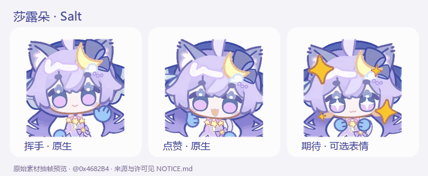
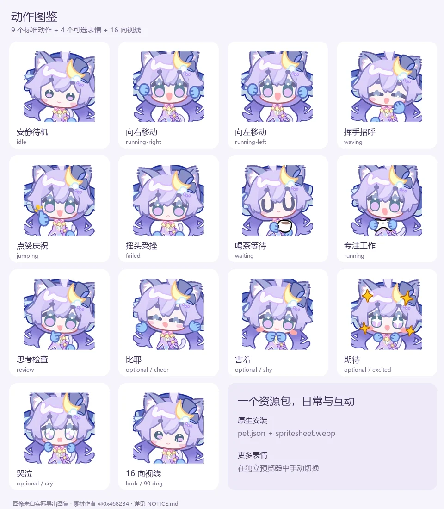

# 莎露朵 · Codex v2 桌宠

让莎露朵（Salt / ソルト）陪伴你的桌面工作：挥手招呼、点赞庆祝、喝茶等待，还有害羞、期待等互动表情。提供可直接安装的 Codex v2 半身桌宠资源包，以及 Web / Electron 预览器与素材制作工具。



[安装教程](#1-安装到-codex原生-v2) · [动作图鉴](#动作与表情) · [浏览器预览](#2-浏览器预览--调试) · [重新生成](#重新生成图集与文档图片) · [素材说明](NOTICE.md)

**只维护一个版本：`pets/salt/`，显示名称「莎露朵」。** 旧默认版与互动版已合并：保留安静待机、挥手和喝茶等待，采用点赞庆祝与摇头受挫，原来的比耶、哭泣以及害羞、期待统一作为可选表情保留。原生安装仍只复制 `pet.json` + `spritesheet.webp`，无需 Python、Node.js 或重新生成图片。

> 素材来源记录：[魔法盐巴表情包](https://www.bilibili.com/video/BV1Te896yE9d/)，作者 [@0x4682B4](https://space.bilibili.com/1354443)。记录的要求为 **禁止商用、禁止投喂 AI、二创请告知**。图片不适用代码的 MIT 许可；维护者已于 2026-11-14 确认本项目素材可公开分发，具体范围和条件见 [NOTICE.md](NOTICE.md)。所有预览由实际导出图集生成，没有 AI 重绘。

## 动作与表情



| 标准状态 | 表情素材 | 帧数 | 播放 |
| --- | --- | ---: | --- |
| `idle` | 呆 3：安静待机 | 6 | 循环 |
| `running-right` / `running-left` | 跳舞：左右移动反馈 | 各 8 | 循环 |
| `waving` | 打招呼 1：挥手 | 4 | 一次 |
| `jumping` | 点赞：完成庆祝 | 5 | 一次 |
| `failed` | 摇头：轻度受挫 | 8 | 一次 |
| `waiting` | 茶（闭眼）：喝茶等待 | 6 | 循环 |
| `running` | 打游戏：专注工作 | 6 | 循环 |
| `review` | 主意：思考检查 | 6 | 循环 |

**Web / Electron 可选表情：** 比耶 `cheer`、害羞 `shy`、期待 `excited`、哭泣 `cry`。在右侧“互动表情”区或 Electron 右键/托盘菜单中选择；比耶、害羞及哭泣播完回 idle，期待循环至切换动作。源 GIF 与具体帧号见 [`expressions.json`](pets/salt/expressions.json)。

**功能范围：** Codex 原生只有固定的九种动作槽，播放触发由客户端决定，不读取可选表情图集。Web / Electron 支持手动动作、单击挥手、双击点赞、16 向视线、缩放、自动演示和可选表情；尚未接入 Codex 任务事件。PySide6 使用主图集与内置时序，暂不读取可选表情。`animation-triggers.json` 中的任务映射、优先级和冷却，以及扩展清单的序列与台词池，目前是供后续集成的声明。

主图集为 **1536×2288、8 列×11 行、192×208 单元格**；第 0–8 行是标准动作，第 9–10 行是 16 向视线，未用格全透明。`000°` 为正上，`090°` 为右，正面回退 idle。[查看完整图集总览](docs/assets/atlas.webp)；布局与研究背景见 [调研文档](docs/01-research.md)。

从旧版本升级：默认 `salt` 用户可按下文复制脚本备份后更新两个文件；曾安装 `salt-expressive` 的用户改为安装并选择 `salt`，确认成功后可手动删除旧的 `pets/salt-expressive` 安装目录。项目不会修改已经安装到用户目录里的桌宠。

## 快速开始

### 1) 安装到 Codex（原生 v2）

#### 先选安装方式

| 你想要的效果 | 使用方式 | 需要安装的东西 |
| --- | --- | --- |
| 出现在客户端的 Pets 列表中 | **本节：原生安装（推荐）** | 支持自定义 v2 桌宠的桌面客户端；无需 Python / Node.js |
| 先在浏览器查看全部动作和视线 | [浏览器预览](#2-浏览器预览--调试) | Python |
| 不依赖客户端，单独启动一个透明桌宠窗口 | [Electron 独立运行](#3-electron-桌宠透明置顶可拖动) | Node.js ≥ 22.12、npm；不会自动连接任务状态 |

以下以已经下载/解压完整项目为前提。目前项目提供源码文件，不假设存在 Release 安装包、安装程序或一键下载链接。命令中的 `D:\Projects\salt-codex-pet` 是示例，请替换成自己的项目解压目录。

#### Windows 方法一：文件管理器手动安装（最直观）

1. 打开项目目录，再进入 `pets\salt`。确认其中有 **`pet.json`** 和 **`spritesheet.webp`**。
2. 同时复制这两个文件。不要复制 `renderer`、整个项目目录或 `pet.extended.json` 来替代 `pet.json`。
3. 按 `Win + R`，输入 `%USERPROFILE%\.codex`，按回车。如果目录不存在，在自己的用户目录下新建 `.codex`。
4. 在 `.codex` 下新建 `pets` 文件夹，再在 `pets` 下新建 `salt` 文件夹。已有目录直接使用。
5. 将两个文件粘贴到 `salt` 中。如果已有同名桌宠，先把旧的两个文件复制到其他文件夹备份，再覆盖。

最终目录应是：

```text
C:\Users\你的用户名\.codex\pets\salt\
├── pet.json
└── spritesheet.webp
```

注意：不能多套一层变成 `pets\salt\salt\pet.json`，也不要把清单保存成 `pet.json.txt`。在文件管理器中开启“查看 → 显示 → 文件扩展名”可以确认后缀。

> 如果你主动设置过 `CODEX_HOME`，安装根目录应改为该客户端实际使用的 `CODEX_HOME`，然后进入其 `pets\salt`。未设置时使用上面的默认目录。WSL 的 `~/.codex` 与 Windows 用户目录不是同一位置，不要混用。

#### Windows 方法二：PowerShell 复制并检查

打开 **Windows PowerShell** 或 Windows Terminal 的 PowerShell 标签页，无需管理员权限。先把第一行的示例路径改成自己的项目目录，再复制执行下面的整段命令。

```powershell
Set-Location -LiteralPath "D:\Projects\salt-codex-pet"
$ErrorActionPreference = "Stop"
$sourceDir = (Resolve-Path -LiteralPath ".\pets\salt").Path
$codexDir = if ([string]::IsNullOrWhiteSpace($env:CODEX_HOME)) {
    Join-Path $env:USERPROFILE ".codex"
} else {
    $env:CODEX_HOME
}
$petDir = Join-Path $codexDir "pets\salt"
$files = @("pet.json", "spritesheet.webp")

# 先检查源文件，再进行复制
foreach ($name in $files) {
    if (-not (Test-Path -LiteralPath (Join-Path $sourceDir $name) -PathType Leaf)) {
        throw "缺少源文件：$name。请确认当前目录是项目根目录。"
    }
}
$manifest = Get-Content -LiteralPath (Join-Path $sourceDir "pet.json") -Raw -Encoding UTF8 | ConvertFrom-Json
if ($manifest.id -ne "salt" -or $manifest.spriteVersionNumber -ne 2 -or $manifest.spritesheetPath -ne "spritesheet.webp") {
    throw "pet.json 与本教程预期不一致，请检查源文件。"
}

# 只备份已有的同名文件，不修改其他桌宠
$existing = @($files | Where-Object { Test-Path -LiteralPath (Join-Path $petDir $_) -PathType Leaf })
if ($existing.Count -gt 0) {
    $backupDir = "$petDir.backup-$(Get-Date -Format 'yyyyMMdd-HHmmssfff')"
    [System.IO.Directory]::CreateDirectory($backupDir) | Out-Null
    foreach ($name in $existing) {
        Copy-Item -LiteralPath (Join-Path $petDir $name) -Destination $backupDir
    }
    Write-Host "旧文件已备份到：$backupDir"
}

[System.IO.Directory]::CreateDirectory($petDir) | Out-Null
foreach ($name in $files) {
    Copy-Item -LiteralPath (Join-Path $sourceDir $name) -Destination $petDir -Force
    $sourceHash = (Get-FileHash -LiteralPath (Join-Path $sourceDir $name) -Algorithm SHA256).Hash
    $targetHash = (Get-FileHash -LiteralPath (Join-Path $petDir $name) -Algorithm SHA256).Hash
    if ($sourceHash -ne $targetHash) { throw "复制校验失败：$name" }
}
Write-Host "安装文件已复制并校验：$petDir"
Get-Item -LiteralPath (Join-Path $petDir "pet.json"), (Join-Path $petDir "spritesheet.webp") |
    Select-Object Name, Length, FullName
```

预期看到“安装文件已复制并校验”，并列出两个文件。当前默认图集大小为 **1,055,010 字节**；若以后更新素材，大小可能变化，以源文件与安装文件的哈希一致为准。

#### 第三步：在客户端选择并显示

1. 保存正在进行的工作，从系统托盘菜单**完整退出客户端**，再重新打开；只关主窗口可能仍有后台进程。
2. 进入 **设置 → Pets（宠物）**。如果页面提供“刷新”按钮，先刷新，再找「**莎露朵**」并选择。
3. 如果已选中却没有悬浮窗口，在命令菜单中找 **Show pet / 显示宠物**；支持该命令的版本也可以输入 `/pet`。入口名称可能因客户端版本不同而变化。
4. 桌面上出现角色即完成安装。动作播放由客户端控制，项目 Web 预览中的调试面板不会一起出现。

OpenAI 当前 [Pets 文档](https://learn.chatgpt.com/docs/pets) 介绍了 Settings → Pets、Show pet 与 `/pet` 的桌面入口；[安装链接文档](https://learn.chatgpt.com/docs/reference/commands#pets) 支持指定 v2。本地双文件安装仍需以你使用的客户端是否支持本地自定义桌宠为准。不要使用 ChatGPT 网页的 PNG 上传要求来缩放本项目的 v2 图集。

#### 不想手动复制？交给 Agent 安装

在能访问本机文件的 Agent 中粘贴下列提示词。这里提供的是教程提示词，不会自动执行安装：

```text
请将本地项目 <替换为项目的完整路径> 中的“莎露朵”安装为 Codex 原生 v2 桌宠。
1. 使用 pets/salt/pet.json 和 pets/salt/spritesheet.webp，不需要下载或重新生成图集。
2. 确认清单 id=salt、spriteVersionNumber=2、spritesheetPath=spritesheet.webp。
3. 确认桌面客户端使用的 CODEX_HOME；未自定义时用 Windows 用户目录下的 .codex。
4. 只复制上述两个文件到 <CODEX_HOME>/pets/salt，不修改其他桌宠。
5. 如果目标中已有同名文件，先备份旧文件，再覆盖；对比源文件与目标文件的 SHA256。
6. 报告实际安装目录与校验结果，提醒我完整退出并重启客户端，在 Pets 中选择“莎露朵”。
7. 不要擅自切换 WSL/Windows 后端，不要修改图集尺寸或转换为 v1。
```

#### macOS 手动安装

在终端中进入项目根目录，运行：

```bash
cd "/你的项目解压路径/pet"
pet_dir="${CODEX_HOME:-$HOME/.codex}/pets/salt"
mkdir -p "$pet_dir"
cp -n pets/salt/pet.json pets/salt/spritesheet.webp "$pet_dir/"
ls -lh "$pet_dir/pet.json" "$pet_dir/spritesheet.webp"
```

`cp -n` 不覆盖已有文件。若要更新，先备份目标中的两个旧文件，再手动替换。完成后重启客户端，在 Pets 中选择「莎露朵」。此处是资源复制步骤，不代表本项目已经在 macOS 做过实机验收。

#### 常见问题：安装后没有显示

| 情况 | 排查方法 |
| --- | --- |
| 提示找不到 `pets\salt` | PowerShell 没有进入项目根目录；先核对 `Set-Location` 的路径 |
| 目录里只有 WebP，没有清单 | 两个文件需要放在同一目录，文件名必须是 `pet.json` |
| 文件正确，列表中没有「莎露朵」 | 检查是否多套目录、清单是否变成 `.txt`；核对客户端使用的 `CODEX_HOME`；完整退出再启动 |
| 没有 Pets 设置入口 | 核对是否使用支持该功能的桌面客户端并检查更新；IDE 扩展和网页不是同一个安装入口 |
| 已选中，桌面没有角色 | 尝试 Show pet / 显示宠物；检查是否选了 Mini、是否隐藏了宠物 |
| 角色不动 | 检查系统“减少动态效果”设置；该设置可能令宠物显示静态帧，见官方 Pets 文档 |
| Windows 使用 WSL 后端 | 先核对 Windows 与 WSL 两侧目录；后端兼容性需结合客户端版本排查，不要直接修改任务执行环境 |
| 想让独立 Electron 桌宠跟随任务 | 当前独立壳没有任务事件连接；原生安装的播放行为由客户端决定 |

可选的只读检查（PowerShell，无需安装 Python）：

```powershell
$codexDir = if ([string]::IsNullOrWhiteSpace($env:CODEX_HOME)) { Join-Path $env:USERPROFILE ".codex" } else { $env:CODEX_HOME }
$petDir = Join-Path $codexDir "pets\salt"
Get-Content -LiteralPath (Join-Path $petDir "pet.json") -Raw -Encoding UTF8
Get-Item -LiteralPath (Join-Path $petDir "spritesheet.webp") | Select-Object Length, FullName
Get-FileHash -LiteralPath (Join-Path $petDir "spritesheet.webp") -Algorithm SHA256
```

#### 更新、卸载与备份

- **更新**：替换项目中的新版本文件后，再执行 Windows 复制脚本；它会备份旧的两个文件。随后完整重启客户端。
- **恢复**：从脚本输出的 `salt.backup-时间戳` 目录中取出两个旧文件，复制回 `pets\salt` 并重启。
- **卸载**：先在 Pets 中选择其他角色或隐藏桌宠，再通过文件管理器仅删除 `pets\salt` 这个文件夹，随后重启。不要删除整个 `.codex` 或 `pets` 目录。旁边的 `salt.backup-*` 是备份，可按需保留。

### 2) 浏览器预览 / 调试

```powershell
python -m http.server 8765 --bind 127.0.0.1
# 打开 http://127.0.0.1:8765/renderer/
```

可拖动（Web 版仅临时偏移画面，松手复位）、单击挥手、双击点赞庆祝、鼠标移动看 16 向视线，右侧可切状态、缩放、开自动演示。调试参数：`?state=waving&frame=1`、`?look=4&frame=0`、`?embed=1`、`?debug=1`。请通过 HTTP 打开；普通浏览器直接打开 `file://` 页面可能连 ES 模块也无法加载，内置清单不能解决这一限制。

### 3) Electron 桌宠（透明、置顶、可拖动）

Web 预览不需要 npm 依赖。Electron 桌宠需 Node.js ≥ 22.12、npm 和可下载的 Electron 二进制；此壳目前按源码目录运行，尚无可分发安装包。依赖固定在 `package-lock.json` 中。

```powershell
cd renderer
npm install
npm start          # npm start -- --dev 打开 DevTools
```

仓库已包含 `package-lock.json`，复现相同依赖可用 `npm ci`。桌面窗口的透明、置顶、托盘与快捷键仍需按自己的系统实机验收。

- 拖动：按住角色拖
- 单击：挥手；双击：点赞庆祝；右键：状态菜单
- 托盘：切换状态、鼠标穿透、置顶、重置位置、退出
- 快捷键：`Ctrl+Alt+P` 鼠标穿透，`Ctrl+Alt+S` 挥手

### 4) PySide6 备选

```powershell
pip install PySide6
python renderer/pyside6/pet_window.py
```

## 重新生成图集与文档图片

原始 GIF 不随项目发布。安装和预览不需要原素材；只有重新选帧时才需要自行准备原 GIF 目录。

```powershell
pip install -r tools/requirements.txt
python tools/build_from_pack.py --source "D:\你的素材目录" --out build/pack-frames
python tools/build_atlas.py --frames-dir build/pack-frames
python tools/validate_atlas.py pets/salt/spritesheet.webp --json-out build/validation.json
python tools/build_readme_media.py
```

- `build_from_pack.py` 的 `PLAN` 定义九个标准动作，`EXPRESSIONS` 定义四个可选表情；原画抽帧后按固定尺度适配，不重绘。
- `build_atlas.py` 合成主图集、构建报告、托盘图标及 QA 总览。不要再使用旧的 `--interactive-out` 参数。
- `build_readme_media.py` 从实际图集重新生成 `demo.gif`、`actions.webp` 和 `atlas.webp`，不需要下载原始 GIF。中文标题需要系统可用的微软雅黑或 Noto CJK 字体。
- 缺少动作会使用程序化后备，少帧会复制末帧，多帧会截断，应检查报告和总览，避免画风混用。不存在的帧目录会报错。
- 不传 `--frames-dir` 会生成程序化替身并覆盖默认输出；试验请指定 `--out build/test-atlas.webp --tray build/test-tray.png`。

通用 GIF 导入示例（透明 GIF 用 `--no-key` 保留 alpha）：

```powershell
python tools/import_gif.py --gif assets/wave.gif --state waving --out build/frames/waving --max-frames 4 --no-key
python tools/build_atlas.py --frames-dir build/frames
```

## 验证与开发

```powershell
npm --prefix renderer test
python -m unittest discover -s tools -p "test_*.py" -v
python tools/validate_atlas.py pets/salt/spritesheet.webp
```

当前验证：主图集校验 0 error / 0 warning；10 项 Python 测试与 JS 状态机、交互、扩展表情回退和 IPC 回归通过。可选表情图集为 1536×832，未使用格透明。README 图像已目检，动图使用统一调色板减少颜色闪烁。测试中的 DOM 与 IPC 使用模拟边界；原生客户端、Electron、PySide6 的真实窗口行为仍需实机验收。

目录结构：

```text
pets/salt/           # 唯一资源包：主清单/图集、扩展表情、来源与报告
renderer/           # Web / Electron 与 PySide6 备选运行器、JS 测试
tools/              # 抽帧、合成、校验、文档图片生成及 Python 测试
docs/               # 研究、素材、安装调试文档与压缩预览图
build/              # 本地中间产物、缓存、旧文件备份，不提交
```

更多安装排查见 [安装与调试](docs/03-install-debug.md)，换素材见 [素材方案](docs/02-asset-plan.md)。后续工作包括真实桌面验收、窗口位置持久化、多屏边界恢复、事件输入与冷却调度，以及分发打包；不代表这些功能已经实现。

## 开源发布范围

- 提交代码、测试、`package-lock.json`、文档、LICENSE 与来源说明；`salt_art.py` 被构建脚本直接依赖，不能当作闲置文件删除。
- 不提交 `build/`、npm/Python 缓存、`node_modules/`、临时文件、本地环境或原始表情包；`build/pack-frames/` 可以在本地备份。
- 原生用户安装包仅需两个文件；完整源码包应保留 `pet.extended.json` 和 `expressions.json` / `expressions.webp`，以提供全部预览功能。
- `.gitignore` 不会过滤手工压缩包，也不会移除已经跟踪的文件。发布前核对实际文件清单。
- 图集、托盘图标和文档预览不属于 MIT 代码许可。维护者已确认本项目的图集、图标与预览可以公开分发；该确认不扩大为商业或 AI 使用许可。原始表情包仍不随项目发布，详见 [NOTICE.md](NOTICE.md)。

## 版权与来源

项目代码与测试按 [MIT License](LICENSE) 提供；角色「莎露朵 / ソルト / Salt」及《maimai》相关权利归 SEGA 等权利人所有。第三方素材与依赖仍适用各自的声明与许可。来源记录、素材范围和授权状态见 [NOTICE.md](NOTICE.md) 与 [SOURCE.md](pets/salt/SOURCE.md)。
